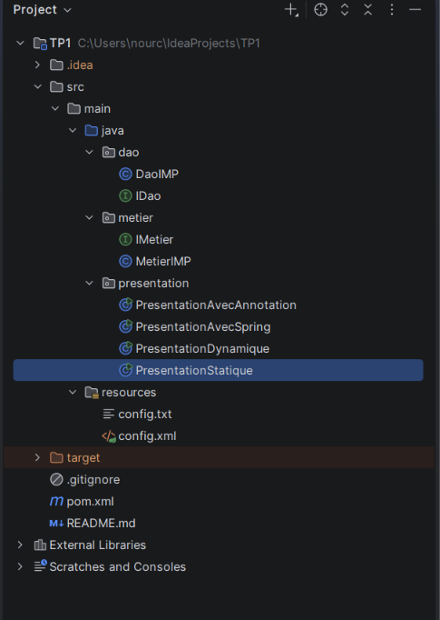
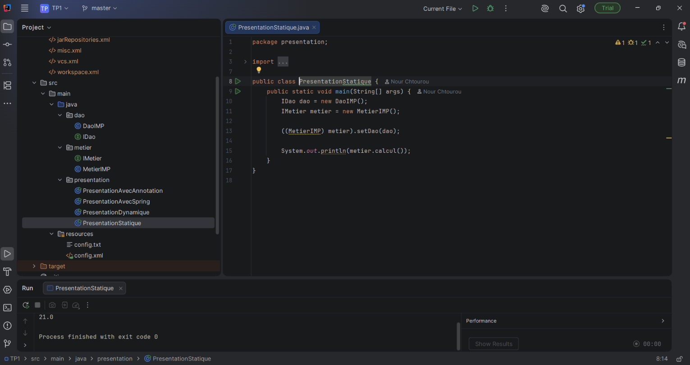
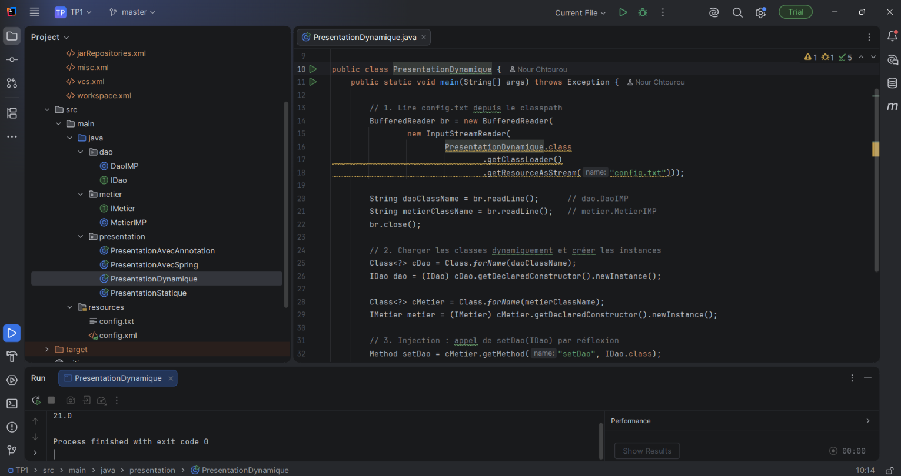
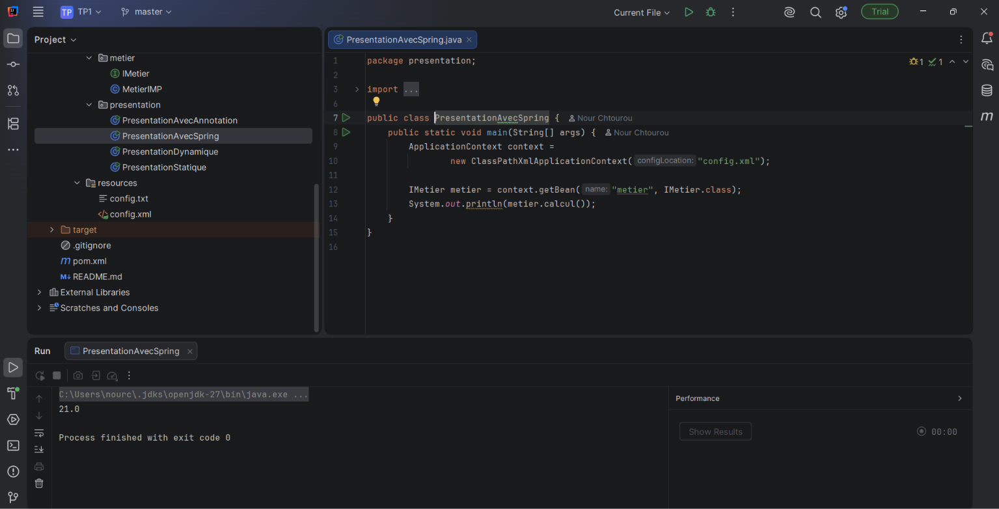
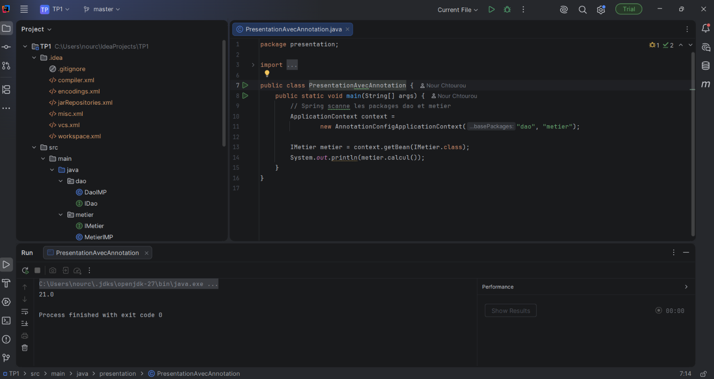

# TP1 : Inversion de Contrôle et Injection de Dépendances

- **Matière :** Architecture MicroServices, MPSRCC1
- **Faculté des Sciences de Sfax**, année universitaire 2026-2027
- **Étudiante :** Nour Chtourou

## Outils
JDK 17 (code compilé pour Java 17), exécuté dans IntelliJ avec le JDK 27, IntelliJ IDEA, Maven, Spring 6.2.8

## Structure du projet
- `dao` : `IDao`, `DaoIMP`
- `metier` : `IMetier`, `MetierIMP`
- `presentation` : `PresentationStatique`, `PresentationDynamique`, `PresentationAvecSpring`, `PresentationAvecAnnotation`
- `resources` : `config.txt`, `config.xml`

## Exécution
Chaque classe de présentation affiche `21.0` (3 x 7). Dans IntelliJ : clic sur le triangle vert à côté de `main`.

---

## Activité 1-1 : instanciation statique

**Réalisation.** `IDao` et `IMetier` sont des interfaces. `DaoIMP` renvoie 3 et `MetierIMP` multiplie cette valeur par 7. Dans `PresentationStatique`, on crée les deux objets avec `new`, puis on appelle `metier.setDao(dao)`.

**Comment cela illustre le couplage faible ?**
`MetierIMP` ne connaît que l'interface `IDao`, jamais la classe `DaoIMP`. Il dépend d'un contrat (`getValue()`), pas d'une implémentation. On peut donc écrire une autre implémentation (par exemple `DaoMySQL`) sans modifier une seule ligne de `MetierIMP`.

**Le principe d'Inversion de Contrôle est-il respecté ?**
Non, pas vraiment. C'est la classe `PresentationStatique` qui décide quelles classes utiliser, qui les crée avec `new` et qui les assemble avec `setDao`. Le contrôle reste dans le code du programmeur. On a de l'injection de dépendances (le DAO vient de l'extérieur), mais pas d'inversion de contrôle.

**Que modifier pour que la présentation ne contrôle plus la création des objets ?**
Sortir les noms de classes du code et confier la création et l'assemblage à un autre mécanisme : un fichier de configuration lu à l'exécution (activité 1-2), puis un conteneur comme Spring (activités 1-3 et 1-4).

---

## Activité 1-2 : instanciation dynamique

**Réalisation.** Le fichier `config.txt` contient `dao.DaoIMP` et `metier.MetierIMP`. `PresentationDynamique` lit ces deux noms, charge les classes avec `Class.forName`, crée les instances avec `getDeclaredConstructor().newInstance()`, puis appelle `setDao` par réflexion avec `Method.invoke`.

**Comment cela illustre l'injection par instanciation dynamique ?**
Le code Java ne contient plus aucun `new DaoIMP()` ni `new MetierIMP()`. Les noms de classes sont lus dans un fichier pendant l'exécution, les objets sont créés par réflexion, et le DAO est injecté dans le métier sans cast vers `MetierIMP`.

**En quoi est-ce plus proche de l'IoC que l'activité 1-1 ?**
Le choix des classes ne se fait plus dans le code mais dans la configuration. Pour changer d'implémentation, il suffit de modifier une ligne de `config.txt`, sans recompiler. Le programme principal ne décide plus des classes concrètes.

**Avantages et limites.**
- Avantages : pas de recompilation pour changer d'implémentation, aucun nom de classe concrète dans le code, application ouverte à l'extension.
- Limites : c'est toujours notre `main` qui lit le fichier et assemble les objets, avec beaucoup de code de réflexion à écrire soi-même. Les erreurs (nom de classe faux, méthode introuvable) n'apparaissent qu'à l'exécution (`ClassNotFoundException`). Le format du fichier est fragile : l'ordre des lignes compte, et gérer plusieurs dépendances serait vite compliqué.

---

## Activité 1-3 : Spring avec un fichier XML

**Réalisation.** `config.xml` déclare deux beans : `dao` (classe `dao.DaoIMP`) et `metier` (classe `metier.MetierIMP`, avec `<property name="dao" ref="dao"/>`). `PresentationAvecSpring` charge le contexte avec `ClassPathXmlApplicationContext("config.xml")` et récupère le bean avec `getBean`. Le `pom.xml` déclare les dépendances Maven `spring-core`, `spring-beans` et `spring-context`.

**Comparaison avec l'activité 1-2 (gestion des dépendances).**
Dans l'activité 1-2, c'est notre code qui lit le fichier, utilise la réflexion et appelle `setDao`. Avec Spring, on déclare seulement les beans et leurs liens dans le XML, et le conteneur fait tout le travail. Le code de présentation se réduit à `getBean`.

**Différence entre les trois façons de créer les objets.**
- Création manuelle (`new`) : le programmeur écrit les classes concrètes dans le code et assemble lui-même les objets. Le couplage est fort, et changer de classe oblige à recompiler.
- Création par réflexion (`Class.forName`) : les noms viennent d'un fichier, mais le programmeur écrit encore le chargement et l'injection.
- Création par le conteneur Spring : le programmeur décrit seulement ce qu'il veut (XML) et le conteneur crée et injecte les objets. C'est l'inversion de contrôle.

---

## Activité 1-4 : Spring avec des annotations

**Réalisation.** `DaoIMP` est annotée `@Repository`, `MetierIMP` est annotée `@Service`, et son attribut `dao` porte `@Autowired`. `PresentationAvecAnnotation` utilise `AnnotationConfigApplicationContext("dao", "metier")` pour scanner les deux packages. Il n'y a plus de `config.xml`.

**Comment Spring gère l'injection avec les annotations ?**
Spring parcourt les packages indiqués et repère les classes marquées `@Repository` ou `@Service`. Il crée un objet (bean) pour chacune. Quand il rencontre `@Autowired` sur l'attribut `dao` de type `IDao`, il cherche un bean compatible (ici `DaoIMP`) et l'injecte automatiquement.

**Pourquoi est-ce plus maintenable que le XML ?**
La configuration se trouve directement dans la classe concernée : plus de fichier XML à maintenir en parallèle. Si on renomme une classe ou qu'on la déplace, il n'y a pas de nom de classe écrit en texte qui devienne faux. Le compilateur et l'IDE détectent les erreurs plus tôt. Ajouter un bean revient à ajouter une annotation.

**En quoi est-ce une application complète du principe IoC ?**
Le programmeur n'écrit plus aucun `new`, aucune lecture de fichier et aucun appel de `setDao`. Le conteneur Spring découvre les classes, les crée et les relie entre elles. Le contrôle de la création et de l'assemblage des objets est entièrement passé du code au framework.

---

## Tableau de synthèse

| Activité | Qui crée et assemble les objets ? | Mécanisme |
|---|---|---|
| 1-1 Statique | Le programmeur | `new` et `setDao()` |
| 1-2 Dynamique | Le programme, via la configuration | `config.txt` et `Class.forName()` |
| 1-3 Spring XML | Le conteneur Spring | `config.xml` (`<bean>`, `<property>`) |
| 1-4 Annotations | Le conteneur Spring | `@Repository`, `@Service`, `@Autowired` |
